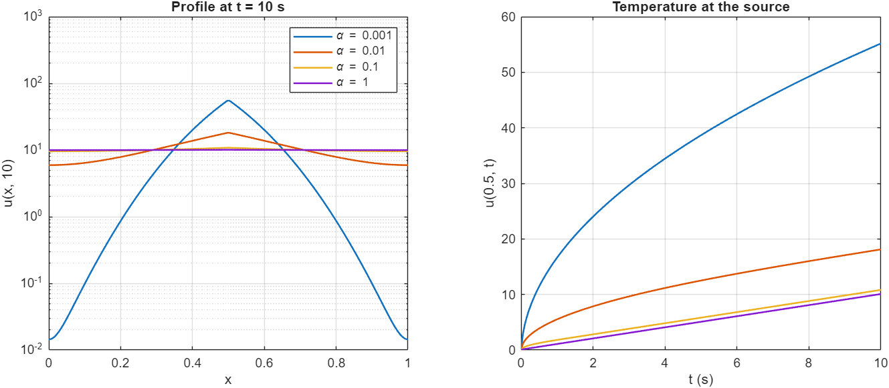
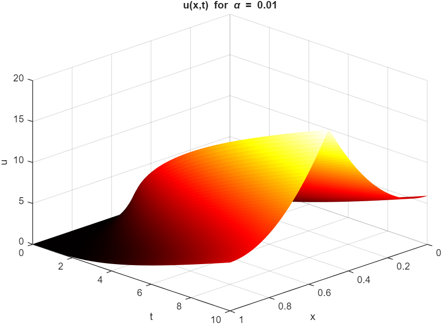
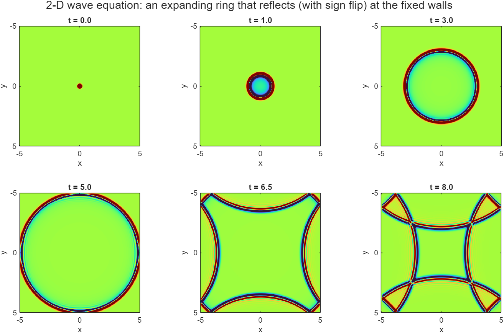

# Engineering Mathematics in MATLAB, Homework 2: Heat and Wave Equations

> **Course:** Engineering Mathematics, Amirkabir University of Technology. Run `main` in MATLAB (base MATLAB only, using `pdepe`); figures go to `results/`.

## Q1: Heat equation with a point source (`pdepe`)
u_t = α u_xx + f(x), with an insulated rod (u_x = 0 at x = 0 and x = 1), u(x, 0) = 0 and 0 < t < 10. The source is f = 100 at x = 0.5. It is modelled as a band of width h = 0.01, which gives a total strength of 1. The mesh has points exactly at the band edges.

**Energy check.** The rod is insulated, so ∫u dx must equal (source strength) × t = 10 at t = 10. The solver gives 10.000 for every α.

| α | u(0.5, 10) | u(0, 10) | ∫u dx |
|---:|---:|---:|---:|
| 0.001 | 55.18 | 0.01 | 10.000 |
| 0.01 | 18.11 | 5.93 | 10.000 |
| 0.1 | 10.82 | 9.58 | 10.000 |
| 1 | 10.08 | 9.96 | 10.000 |

**What the table shows.** With small α, the heat stays at the source and builds into a sharp peak. With large α, it spreads almost uniformly, so u → t everywhere.

| α sweep | u(x, t) for α = 0.01 |
|---|---|
|  |  |

## Q2: 2-D wave equation (finite differences)
u_tt = u_xx + u_yy on [−5, 5]², with u = 0 on the walls, u(x, y, 0) = exp(−100(x² + y²)) and u_t(x, y, 0) = 0.

**Method.**
- **Grid:** a 401 × 401 grid with leapfrog time-stepping.
- **Time step:** dt = dx/2, which satisfies the 2-D CFL limit dt ≤ dx/√2.
- **First step:** a second-order Taylor start that respects u_t = 0.

**Energy check.** The scheme conserves its discrete energy. Over 8 s the relative drift is **7 × 10⁻¹⁶**.

**What the snapshots show.** The pulse spreads as a ring, hits the fixed walls at about t = 5, and comes back inverted.

## Changes compared with the original submission
- **Q1 source.** The original source `100*(x == 0.5)` worked only because one `pdepe` evaluation midpoint landed exactly on 0.5. With a 101-point grid instead of 100, the source vanishes completely and u stays at 0. The source is now a band of finite width with mesh points at its edges, so the result no longer depends on the grid. An energy check and an α sweep were added.
- **Q2 initial condition.** The original built it from row vectors instead of `meshgrid`, so it was a ridge, not a 2-D Gaussian.
- **Q2 grid spacing and first step.** dx was computed incorrectly, and the first time step u(:,:,2) was never initialised. Both are fixed.
- **Q2 outputs.** Dirichlet walls are now enforced explicitly, and the animations became snapshot figures with an energy-conservation check.

**Sepehr Ebrahimi**, B.Sc. Electrical Engineering, Amirkabir University of Technology (2026)
